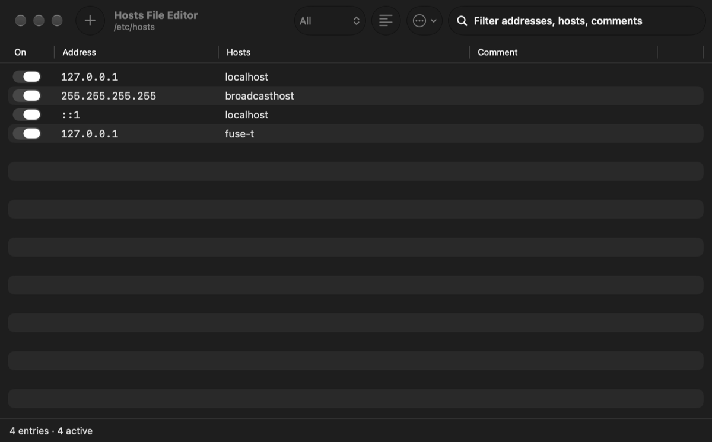

# Hosts Editor for macOS

A small native macOS app for editing `/etc/hosts`, in the spirit of the PowerToys Hosts File Editor on Windows.



## Install

```bash
curl -fsSL https://raw.githubusercontent.com/arifcinartekin/hostseditor/main/install.sh | bash
```

This downloads the latest release (a universal build for Apple Silicon and Intel), installs it to `/Applications`, and opens it. If no release can be downloaded, the script builds the app from source instead, which needs the Xcode Command Line Tools (`xcode-select --install`).

You need macOS 14 (Sonoma) or newer.

## Features

- Every entry in a table: an on/off switch, the address, its hosts and a comment
- Switch an entry off without deleting it (it's saved as a `#` comment line)
- Add (⌘N) and edit (double-click) entries. IPv4/IPv6 addresses and host names are checked as you type
- Right-click an entry to duplicate it, ping it, move it up or down, copy its line or delete it. Select several entries to enable, disable or ping them all at once
- Search and filter by All / Active / Inactive / Duplicates
- Entries that share a host name with another entry get a warning icon
- Edit the comment block at the top of the file ("Additional Lines")
- Lines you don't touch, including comments, blank lines and spacing, are written back exactly as they were
- The app notices when another program changes the file and offers to reload it
- If you quit with unsaved changes, it asks whether to save them

## How saving works

`/etc/hosts` is owned by root. When you press **Save** (⌘S), macOS shows its own administrator password prompt. The app then:

1. copies the original file to `/etc/hosts.hostseditor.bak` (on the first save after each launch),
2. writes the new contents into `/etc/hosts`, keeping its owner and permissions,
3. flushes the DNS cache (`dscacheutil -flushcache` and `killall -HUP mDNSResponder`).

The app never stores or sees your password.

## Build from source

```bash
git clone https://github.com/arifcinartekin/hostseditor.git
cd hostseditor
./build.sh             # builds build/Hosts Editor.app (universal)
./build.sh --install   # also copies it to /Applications
```

Run `ARCHS=arm64 ./build.sh` for a faster build that targets your Mac's architecture only. No Xcode project is needed: the build runs `swiftc` from the Command Line Tools.

## Uninstall

```bash
rm -rf "/Applications/Hosts Editor.app"
```
